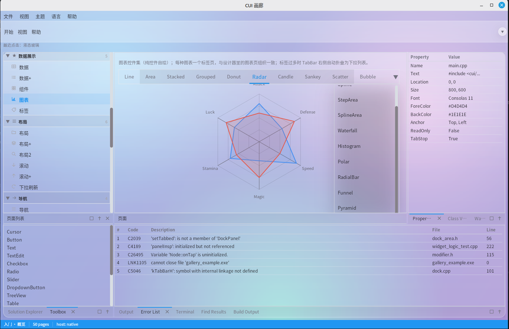
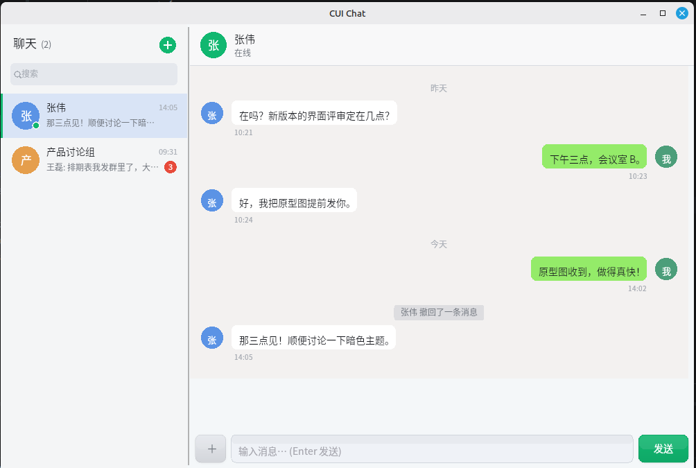
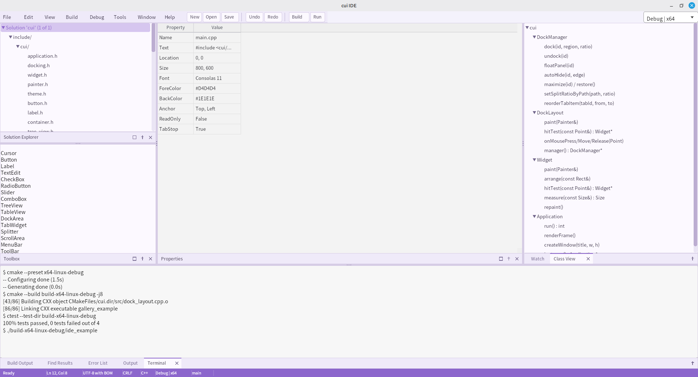

# CUI

一个基于 **C++20 + Skia** 的跨平台自绘 GUI 框架，采用 **三层架构**（Widget/Element/RenderObject）+ 响应式单向数据流，灵感来源于现代声明式 UI 框架与 Redux。

## 设计理念

CUI 将现代前端框架的核心思想引入 C++ 桌面开发：

```
    ┌──────────┐    State     ┌──────┐
    │  Store   │─────────────▶│ View │
    │(Reducer) │              │      │
    └────▲─────┘              └──┬───┘
         │                       │
    Action/Intent          User interaction
         │                       │
    ┌────┴───────────────────────▼───┐
    │         dispatch()             │
    └────────────────────────────────┘
```

- **Store** — 唯一状态源，持有应用状态
- **Action** — 用户意图（Increment、Decrement…）
- **Reducer** — 纯函数，`(State, Action) → NewState`
- **View** — 状态的纯函数，通过 Signal/Observable 响应式更新

## 快速开始

### 依赖

- C++20 编译器（GCC 13+ / Clang 16+ / MSVC 19.35+）
- CMake 3.20+、Ninja
- [vcpkg](https://github.com/microsoft/vcpkg)（管理 Skia 等依赖，需设置 `VCPKG_ROOT`）
- Linux: `libxcb`、`fontconfig`、`libX11`（可选，用于 CJK 输入法）
- Android 需要 `ANDROID_NDK_HOME`，Web 需要 [emsdk](https://emscripten.org/)（`EMSDK`，或 `build.sh web --install-emsdk` 自动安装）

### 构建

一键脚本（Windows 不需要 Git Bash；参数最终转成预设调用）：

```bat
build.cmd                 :: 当前主机 debug 全量构建 + ctest
build.cmd release         :: Release
build.cmd --help          :: 平台 / profile / 全部选项
```

```bash
bash build.sh                # Linux / macOS 同上
bash build.sh linux asan     # Sanitizer
bash build.sh web --serve    # 构建 wasm 并起本地 HTTP 服务
```

也可以直接走 [CMakePresets.json](CMakePresets.json)：

```bash
cmake --list-presets=all          # 查看本机可用预设
cmake --preset x64-linux-debug    # 或 x64-windows-debug / macos-arm64-debug / wasm32-emscripten-debug …
cmake --build --preset x64-linux-debug
ctest --preset x64-linux-debug    # 原生平台注册了测试

# 运行示例
./dist/demo_gallery
```

安装、打包、各平台调试与 Sanitizer 的完整说明见
[docs/BUILDING.md](docs/BUILDING.md)；Web 端特有限制见
[src/platform/web/README.md](cui_core/src/platform/web/README.md)。

### 最小示例

```cpp
#include <cui/foundation/application.h>
#include <cui/widgets/basic.h>        // Column
#include <cui/widgets/interactive.h>  // ElevatedButton
#include <cui/widgets/text.h>         // Text / TextStyle

int main() {
    using namespace cui;

    Application app;
    app.createWindow("Hello CUI", 400, 300);

    auto label = std::make_shared<Text>("Hello, World!", TextStyle().size(24.0));

    auto btn = std::make_shared<ElevatedButton>(
        std::make_shared<Text>("Click Me"), [label] {
            label->setText("Clicked!");
        });

    auto box = std::make_shared<Column>(
        std::vector<std::shared_ptr<Widget>>{label, btn});
    box->setMainAxisSize(MainAxisSize::Min);

    app.setRoot(box);          // 直接挂载控件树
    return app.run();
}
```

### MVI 模式示例

```cpp
// 状态
struct CounterState { int count = 0; };

// 意图
struct Increment {};
struct Decrement {};
using Action = std::variant<Increment, Decrement>;

// Reducer
auto reducer = [](const CounterState& s, const Action& a) -> CounterState {
    return std::visit([&](auto&& intent) -> CounterState {
        using T = std::decay_t<decltype(intent)>;
        if constexpr (std::is_same_v<T, Increment>) return {s.count + 1};
        if constexpr (std::is_same_v<T, Decrement>) return {s.count - 1};
        return s;
    }, a);
};

// 使用
Store<CounterState, Action> store(CounterState{}, reducer);
store.dispatch(Increment{});
store.subscribe([](const CounterState& s) { /* 更新视图 */ });
```

## 控件一览

### 基础控件

| 控件 | 说明 |
|------|------|
| `Button` | 按钮，支持海拔阴影与焦点环 |
| `Checkbox` | 复选框 |
| `Radio` / `ButtonGroup` | 单选按钮（互斥组） |
| `Slider` | 滑动条 |
| `LinearProgressIndicator` | 进度条 |
| `Switch` | 开关 |
| `SpinBox` | 数值输入框（前缀/后缀） |
| `DropdownButton` | 下拉选择框 |
| `TextField` | 单行文本输入 |
| `TextEdit` | 多行文本编辑器 |

### 数据展示

| 控件 | 说明 |
|------|------|
| `Text` | 文本标签 |
| `Card` | 卡片容器（带海拔阴影） |
| `Badge` | 徽标（数字/红点） |
| `CircleAvatar` | 头像（圆形/圆角） |
| `Chip` | 标签/筛选条 |
| `Tooltip` | 工具提示 |
| `TableView` | 表格视图 |
| `TreeView` | 树形视图 |
| `ListView` / `ListWidget` | 列表视图（虚拟列表：懒加载 Model，只渲染可见行） |
| `GridView` | 网格视图 |
| `Calendar` | 日历 |

#### 虚拟列表 (Virtual List)

`ListView` 基于 `ListModel` 抽象按需读取数据：每帧只查询、只绘制可见行
（O(visible)，与总行数无关），百万行数据无需全部驻留内存。

```cpp
class LogModel : public ListModel {
public:
    int rowCount() const override { return 1'000'000; }
    std::string data(int row) const override {
        return "Log entry #" + std::to_string(row + 1);  // 按需生成
    }
};

auto list = std::make_shared<ListView>();
list->setModel(std::make_shared<LogModel>());
```

- `StringListModel` / `ListWidget` — 内存数据源的便捷实现
- 交互：滚轮 / 滚动条（thumb 拖拽 + 轨道翻页）/ 键盘导航
  （Up/Down/PageUp/PageDown/Home/End，Return 激活）/ 双击
- `modelReset()` 信号：批量数据变更后重新钳制滚动位置并清理越界选择

### 布局系统

| 控件 | 说明 |
|------|------|
| `Column` / `Row` | 垂直 / 水平排列 |
| `Flex` / `Expanded` | 弹性布局（flex-grow / flex-shrink） |
| `Wrap` | 自动换行布局 |
| `Stack` / `Positioned` | 层叠布局 |
| `Align` / `Center` | 对齐容器 |
| `SizedBox` | 固定尺寸容器 |
| `Container` | 装饰 + 内边距 + 约束组合 |
| `SingleChildScrollView` / `ListView` / `GridView` | 滚动区域 |
| `Splitter` | 可拖拽分割条 |

### 高级组件

| 控件 | 说明 |
|------|------|
| `TabBar` / `TabBarView` | 标签页与标签页视图 |
| `Ribbon` | Office 风格功能区工具栏 |
| `Docking` / `RootDockingPanel` | Visual Studio 风格停靠面板 |
| `MenuBar` | 菜单栏 |
| `AlertDialog` / `SimpleDialog` | 对话框 |
| `PopupMenuButton` | 弹出菜单 |
| `Drawer` | 侧边抽屉 |
| `BottomSheet` | 底部弹出面板 |
| `NavigationRail` | 导航栏 |
| `ExpansionTile` | 可展开列表项 |
| `Stepper` | 步骤条 |
| `SearchBar` | 搜索栏 |
| `RatingBar` | 评分条 |
| `ColorPicker` | 颜色选择器 |
| `TimePicker` / `DatePicker` | 时间/日期选择器 |

### Material Design 3 交互特性

| 特性 | 说明 |
|------|------|
| `InkWell` | 涟漪效果包装器 |
| `AnimatedWidget` | 自驱动动画包装器（opacity/scale） |
| `Animation` | 动画控制器（25 种缓动函数） |
| `SnackBar` / `Banner` | 消息提示 |

#### InkWell 涟漪效果

从触摸点扩散的涟漪动画，使用 ease-out cubic 缓动：

```cpp
void InkWell::startRipple(const Point& localPos) {
    ripple_.active = true;
    ripple_.origin = localPos;
    ripple_.startTime = std::chrono::steady_clock::now();
    // 计算到最远角落的距离作为最大半径
    double dx = std::max(localPos.x, w - localPos.x);
    double dy = std::max(localPos.y, h - localPos.y);
    ripple_.maxRadius = std::sqrt(dx * dx + dy * dy);
}
```

特性：
- 从点击位置开始扩散
- 自动计算到最远角落的距离
- 透明度从 `rippleAlpha` 渐变到 0
- 动画期间持续重绘

#### 焦点环

Button、Checkbox、Radio 等控件支持可见焦点环，提升可访问性：

```cpp
// Button 焦点环（圆角矩形）
if (focused_) {
    p.setLineWidth(theme().focusRingWidth);
    p.roundedRectangle(
        {-ringOffset, -ringOffset, w + ringOffset * 2, h + ringOffset * 2},
        radius + theme().focusRingRadius);
    p.stroke();
}

// Radio 焦点环（圆形）
if (focused_) {
    p.circle(cx, cy, outerR + ringOffset + theme().focusRingRadius);
    p.stroke();
}
```

焦点事件处理：
```cpp
void Button::onFocusEvent(bool focused) {
    focused_ = focused;
    repaint();
    Widget::onFocusEvent(focused);
}
```

## 核心架构

### 三层引擎

CUI 采用 Widget / Element / RenderObject 三层对象模型，从结构上根治动画停滞、脏节点调度等经典问题：

```
    ┌──────────┐    createElement()    ┌──────────┐    owns    ┌──────────────┐
    │  Widget   │─────────────────────▶│ Element  │──────────▶│ RenderObject │
    │(配置蓝图) │                      │(生命周期) │           │(布局/绘制)    │
    └──────────┘                      └────┬─────┘           └──────────────┘
                                           │
                                      BuildOwner
                                     (脏 Element 重建队列)
```

| 层 | 职责 | 关键类 |
|----|------|--------|
| **Foundation** | 几何原语、树节点、Layer 树、Ticker | `Key`, `Offset`, `BoxConstraints`, `AbstractNode`, `Layer`, `Ticker` |
| **Rendering** | 布局/绘制/命中测试/脏节点调度 | `RenderObject`, `RenderBox`, `RenderView`, `PipelineOwner`, `PaintingContext`, `RepaintBoundary` |
| **Framework** | Element 生命周期、帧调度、焦点/浮层 | `Element`, `BuildOwner`, `SchedulerBinding`, `FocusManager`, `Overlay`, `Widget/State` |

#### 帧五阶段

每帧按固定顺序执行：

| 阶段 | 职责 |
|------|------|
| 1. handleBeginFrame | 推进所有活跃 Ticker（动画时间在此更新，**不在 paint 内**） |
| 2. flushBuildScope | 重建脏 Element（setState 触发的 UI 更新） |
| 3. flushLayout | 重新布局脏 RenderObject |
| 4. flushCompositingBits | 传播 needsCompositing 标志 |
| 5. flushPaint + composite | 重新绘制脏 RenderObject → Layer 树 → 光栅化到 SkCanvas |

#### 动画与绘制解耦

旧模式（动画在 paint 内推进 + repaint 续帧）已替换为 Ticker 驱动：

```cpp
// 新方式：Ticker 在 handleBeginFrame 推进动画，与绘制完全解耦
auto ticker = std::make_unique<Ticker>([this](Duration elapsed) {
    animation_.tick(elapsed);           // 推进动画
    renderObject_->markNeedsPaint();    // 标记脏
});
ticker->start();
```

### 响应式原语

```
Signal<Args...>     ── 类型安全的信号/槽，支持 connect/disconnect/emit
Observable<T>       ── 响应式流，支持 filter/map/take_until/combine_latest
Property<T>         ── 可观察属性（值变化时自动通知）
Store<State,Action> ── MVI Store（单向数据流）
```

### 布局协议

约束式布局，每个控件实现两个方法：

```cpp
Size measure(const Size& available);  // 计算期望尺寸
void arrange(const Rect& rect);       // 确定最终位置和大小
```

### 主题系统

运行时可切换的多主题系统，支持 4 种内置预设：

```cpp
theme() = Theme::light();    // 亮色
theme() = Theme::dark();     // 暗色
theme() = Theme::ocean();    // 海洋
theme() = Theme::forest();   // 森林

// 自定义单个字段
theme().primary = Color::fromRGB(0.8, 0.2, 0.5);
```

#### 海拔系统 (Elevation System)

参考 Material Design 3 的统一海拔层级，为控件提供一致的阴影效果：

| 级别 | 用途 | offset | shadowAlpha | blurRadius |
|------|------|--------|-------------|------------|
| elevation0 | 无海拔 | 0.0 | 0 | 0.0 |
| elevation1 | 卡片、按钮 | 1.0 | 12 | 2.0 |
| elevation2 | 抬起卡片 | 2.0 | 18 | 4.0 |
| elevation3 | 浮动、对话框 | 3.0 | 24 | 6.0 |
| elevation6 | 菜单、弹出框 | 6.0 | 30 | 10.0 |
| elevation8 | 导航抽屉 | 8.0 | 36 | 14.0 |
| elevation12 | 底部表单 | 12.0 | 42 | 18.0 |
| elevation16 | 模态对话框 | 16.0 | 48 | 22.0 |

控件根据状态自动切换海拔：Button 默认 elevation1，悬停 elevation3，聚焦 elevation2，按下 elevation1。

#### 语义化色彩体系

```cpp
// 主要色系
primary              // 主要强调色
primaryContainer     // 主要容器背景
onPrimaryContainer   // 主要容器上的文字

// 辅助色系
secondary            // 辅助强调色
secondaryContainer   // 辅助容器背景

// 第三色系
tertiary             // 第三强调色
tertiaryContainer    // 第三容器背景

// 轮廓和遮罩
outline              // 重要轮廓
outlineVariant       // 微妙轮廓
scrim                // 遮罩层（对话框背景）
```

#### 交互状态覆盖层

```cpp
ripple          // 涟漪效果颜色（primary + alpha）
hoverOverlay    // 悬停状态覆盖层
pressedOverlay  // 按下状态覆盖层
```

#### 焦点环与涟漪配置

```cpp
// 焦点环
focusRingWidth    = 2.0   // 焦点环宽度
focusRingOffset   = 2.0   // 焦点环与控件间隙
focusRingRadius   = 4.0   // 焦点环额外圆角

// 涟漪效果
rippleDuration    = 300.0  // 涟漪动画时长（ms）
rippleMaxRadius   = 150.0  // 最大半径（px）
rippleAlpha       = 40     // 透明度（0-255）
```

#### 其他主题令牌

- **间距系统** — spacingXS / SM / MD / LG / XL
- **圆角系统** — radiusSmall / radiusMedium / radiusLarge / radiusPill
- **字体层级** — fontSizeCaption / Body / Subtitle / Title / Headline

### 动画系统

内置动画框架，提供 25 种缓动函数和完整的动画生命周期管理。

#### 核心组件

**Animation** — 基础动画控制器，管理时间、进度和状态：

```cpp
auto anim = std::make_shared<Animation>(300);  // 300ms
anim->setEasing(Easing::EaseOutCubic);
anim->progressChanged().subscribe([](double p) {
    // p: 0.0 → 1.0
});
anim->finished().connect([] { /* 动画完成 */ });
anim->start();
```

**ValueAnimation<T>** — 在两个值之间进行插值动画：

```cpp
// 透明度动画
auto fade = std::make_shared<ValueAnimation<double>>(0.0, 1.0, 500);
fade->setEasing(Easing::EaseInOutSine);
fade->onUpdate([](double v) { widget->setOpacity(v); });
fade->start();

// 颜色动画
auto color = std::make_shared<ValueAnimation<Color>>(
    Color::fromRGB(1, 0, 0), Color::fromRGB(0, 0, 1), 1000);
color->onUpdate([](const Color& c) { widget->setColor(c); });

// 位置动画（弹簧效果）
auto move = std::make_shared<ValueAnimation<Point>>(
    Point{0, 0}, Point{100, 200}, 600);
move->setEasing(Easing::Spring);
```

#### 动画配置

```cpp
anim->setLoop(true);        // 无限循环
anim->setAutoReverse(true); // 正向播放后反向
anim->setDelay(200);        // 延迟 200ms 启动
anim->pause();              // 暂停
anim->resume();             // 恢复
```

#### Widget 集成

```cpp
class MyWidget : public Widget {
public:
    MyWidget() {
        auto anim = std::make_shared<Animation>(300);
        anim->progressChanged().subscribe([this](double p) {
            opacity_ = p;
            repaint();  // 触发重绘
        });
        addAnimation(anim);  // 生命周期绑定
        anim->start();
    }
    void paint(Painter& p) override {
        updateAnimations();  // 更新所有动画
        p.setOpacity(opacity_);
        // ... 绘制代码
    }
};
```

#### 25 种缓动函数

| 类别 | 函数 |
|------|------|
| 线性 | `Linear` |
| 二次方 | `EaseInQuad`, `EaseOutQuad`, `EaseInOutQuad` |
| 三次方 | `EaseInCubic`, `EaseOutCubic`, `EaseInOutCubic` |
| 四次方 | `EaseInQuart`, `EaseOutQuart`, `EaseInOutQuart` |
| 五次方 | `EaseInQuint`, `EaseOutQuint`, `EaseInOutQuint` |
| 正弦 | `EaseInSine`, `EaseOutSine`, `EaseInOutSine` |
| 指数 | `EaseInExpo`, `EaseOutExpo`, `EaseInOutExpo` |
| 圆形 | `EaseInCirc`, `EaseOutCirc`, `EaseInOutCirc` |
| 回弹 | `EaseInBack`, `EaseOutBack`, `EaseInOutBack` |
| 弹性 | `EaseInElastic`, `EaseOutElastic`, `EaseInOutElastic` |
| 弹簧 | `Spring` |

#### 实用函数

```cpp
auto fadeIn = cui::fadeIn(300);    // 淡入
auto slideIn = cui::slideIn(300);  // 滑入（EaseOutCubic）
```

#### 最佳实践

1. 使用 `std::shared_ptr` 管理动画对象
2. 在构造函数中添加动画，确保生命周期与 Widget 一致
3. 使用 `onUpdate` 回调比订阅 `progressChanged` 更简洁
4. 多个动画可同时运行，实现复杂组合效果
5. 缓动选择建议：UI 过渡用 `EaseInOutCubic`，物理效果用 `Spring`，简单提示用 `EaseOutQuad`，加载指示用 `Linear`

#### 动画能力一览

| 特性 | CUI |
|------|----------|
| 缓动函数 | 25 种 |
| 值动画 | `Tween` + `Animation` |
| 控制器 | `Animation` |
| Widget 集成 | `StatefulWidget` / `State` |
| 响应式 | `Observable` / `ValueListenable` |
| 弹簧动画 | `Easing::Spring` |

### 异步任务

```cpp
// 线程池 + 回调（自动回到 GUI 线程）
app.runAsync(
    [] { return heavyComputation(); },        // 后台线程执行
    [](auto result) { updateUI(result); }     // GUI 线程回调
);
```

### 弹出层机制

下拉菜单、Tooltip 等需要覆盖在其他控件上方的元素通过统一的弹出层管理：

```cpp
app.addPopup(widget);    // 注册为顶层弹出层
app.removePopup(widget); // 移除
```

弹出层在每帧最后绘制（覆盖整个控件树），并优先接收鼠标事件。

### 国际化 (i18n)

类似 Android 的字符串资源机制，支持从外部 XML/INI 文件加载翻译：

#### 资源文件结构

```
res/
├── values/strings.xml          ← 英语（默认）
├── values-zh/strings.xml       ← 中文
└── translations.ini            ← INI 备选格式
```

#### XML 格式（Android 风格）

```xml
<?xml version="1.0" encoding="utf-8"?>
<resources>
    <string name="home">Home</string>
    <string name="settings">Settings</string>
</resources>
```

#### INI 格式（单文件多语言）

```ini
[en]
home=Home
settings=Settings

[zh]
home=主页
settings=设置
```

#### 使用方式

```cpp
// 方式一：Android 风格目录扫描（推荐）
Translator::instance().loadFromDirectory("res");

// 方式二：加载单个文件
Translator::instance().loadXmlFile("strings.xml", "zh");
Translator::instance().loadIniFile("translations.ini");

// 切换语言
Translator::instance().setLanguage("zh");
auto text = tr("home");  // → "主页"
```

新增语言只需创建 `examples/res`，无需修改代码。

## 平台支持

| 平台 | 窗口系统 | 状态 |
|------|---------|------|
| Linux | XCB + Xlib (XIM) | ✅ 完整支持 |
| Windows | Win32 | 🔧 桩代码 |
| macOS | Cocoa | 🔧 桩代码 |
| iOS | UIKit | 🔧 桩代码 |
| Android | Android NDK | 🔧 桩代码 |
| Web | Emscripten | 🔧 桩代码 |

## 项目结构

```
cui/
├── include/cui/           # 公共头文件
│   ├── foundation/            # Foundation 层：Key/Offset/Layer/Ticker 等
│   ├── rendering/             # Rendering 层：RenderObject/PipelineOwner 等
│   ├── framework/             # Framework 层：Element/BuildOwner/Binding 等
│   ├── platform/              # 平台窗口抽象
│   ├── widget.h               # 旧控件基类（仍工作，可逐步迁移）
│   ├── application.h          # 应用入口 & 事件循环
│   ├── animation.h            # 动画系统（支持 Ticker 驱动）
│   ├── theme.h                # 主题系统
│   └── ...                    # 80+ 控件头文件
├── src/
│   ├── foundation/            # Foundation 层实现
│   ├── rendering/             # Rendering 层实现
│   ├── framework/             # Framework 层实现
│   └── platform/              # 全部平台实现
│       ├── win32_window.cpp / x11_window.cpp / wayland_window.cpp
│       ├── cocoa_window.mm / ios_window.mm / android_window.cpp / web_window.cpp
│       ├── services/              # 平台通道、权限、相机、蓝牙等平台服务
│       ├── android/java/          # Android JNI 宿主参考实现
│       ├── ios/                   # iOS Swift 桥宿主参考实现
│       ├── ohos/                  # HarmonyOS ArkTS 桥宿主参考实现
│       └── web/                   # Emscripten shell.html 与说明
├── cmake/                   # 一键构建入口实现（build.cmake + platforms/*.cmake）
├── build.cmd / build.sh       # 仓库根的一键构建入口（Windows / Linux·macOS）
├── res/                       # 资源文件（Android 风格）
├── examples/                  # 示例程序
├── tests/                     # 测试
├── CMakeLists.txt             # 顶层构建配置
└── vcpkg.json                 # 依赖声明
```

## 示例程序

<p align="center">
  <a href="examples/gallery.cpp"></a>
  <br/>
  <em>Gallery — 全控件展示</em> <code>gallery_example</code>
</p>

<p align="center">
  <a href="examples/chat.cpp"></a>
  <br/>
  <em>Chat — 聊天界面</em> <code>chat_example</code>
</p>

<p align="center">
  <a href="examples/ide.cpp"></a>
  <br/>
  <em>IDE — 停靠面板</em> <code>ide_example</code>
</p>

<details>
<summary><b>其他示例</b></summary>

| 目标 | 说明 |
|------|------|
| `counter_example` | MVI 模式最小示例 |
| `spreadsheet_example` | 类 Excel 表格（键盘导航 + 编辑） |
| `animation_demo` | 动画系统演示（缓动函数 + 值动画） |
| `async_demo` | 异步任务 + 线程池 |
| `custom_widget_example` | 自定义自绘控件 |

</details>

## 输入法支持

Linux 平台通过 XIM 协议支持 CJK 输入法：

- 预编辑字符串（preedit）实时显示
- 候选窗口跟随光标位置
- 通过 `Widget::imCommit()` 接收输入法提交的文本

## 许可证

MIT License
