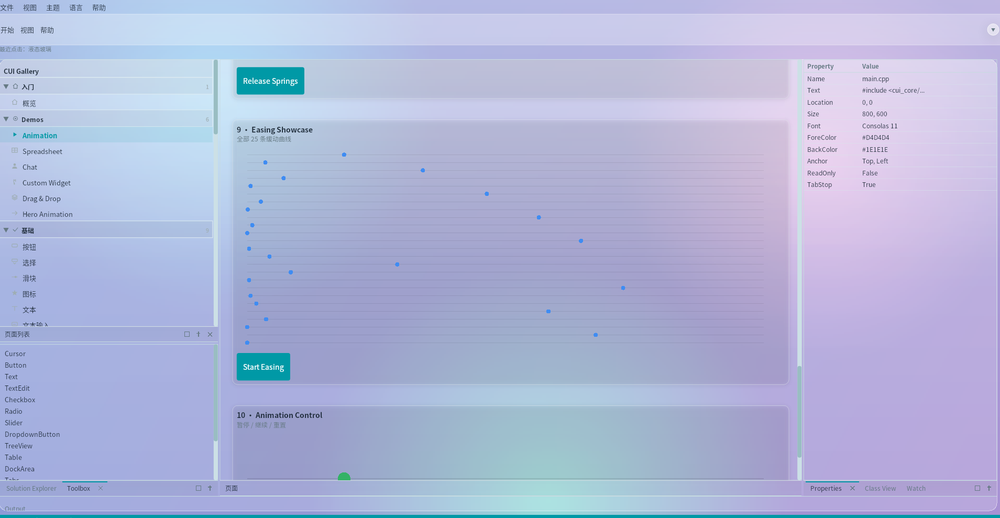

# Flutter-CXX (Flutter for C++)

A cross-platform **self-drawn GUI framework** built on **C++20 + Skia**: the **Widget / Element / RenderObject three-layer pipeline** plus a unidirectional reactive data flow. Widgets, layout, animation and rasterization are all produced by the framework itself — one codebase covers desktop, mobile and Web.

[English](README.md) | [简体中文](README_zh.md)

<p align="center">
  &nbsp;
  
</p>

<p align="center">
  &nbsp;
  &nbsp;
  &nbsp;
  
</p>

<p align="center">
  &nbsp;
  &nbsp;
  
</p>

## Gallery

Everything below is drawn by the framework itself (Skia software raster) — no native widget is involved on any platform.

| | |
|:---:|:---:|
| <br>**`story` in its dockable IDE-style shell** — the *Charts* page, radar tab. Fourteen self-drawn chart widgets behind one `ChartHost`, with the tab bar folding into a dropdown when it overflows. | <br>**Chat demo** (`CUI_PAGE=3`) — conversation list, bubbles, date separators, unread badge, `CircleAvatar`, input bar with IME-ready text editing. |
| <br>**Animation page** (`CUI_PAGE=1`) — the easing-curve showcase, one row of dots per curve, driven by `AnimationController` + `CurvedAnimation`. Shot in the “liquid glass” look (`CUI_GLASS=1`). | <br>**Visual designer** — target `vs2022` (`CUI_BUILD_IDE`, sources in [`ide/`](ide)): solution tree, toolbox, property grid, class view and an embedded terminal. |

The gallery window mounts the same dock layout as the designer (`cui_dock`): page list, solution explorer, toolbox, property grid, terminal, error list. Its status bar shows the page count *at the time of the shot* — the live count is in the section on examples below.

Re-shooting any page locally:

```bash
CUI_PAGE=19 CUI_SHOT=charts.png CUI_EXIT_AFTER_START=1 ./dist/story
CUI_PAGE=1  CUI_GLASS=1 CUI_SHOT=animation.png CUI_EXIT_AFTER_START=1 ./dist/story
```

- The engine core (`cui_core`), the widget layer (`cui_wx`) and the four widget packages under `packages/*` share one `cui` namespace and one include style (`#include "cui/..."`).
- The desktop sample [`story`](examples/story.cpp) is a **51-page** widget tree — charts, video, docking, image tools, a visual-designer shell and more — and it is the *same* tree on Web, Android and OHOS.
- Optional state management via `Store<State, Action>` (MVI): `dispatch(Action) → reducer → Property.changed() → setState()`. An interactive demo lives on the [Value Input page](examples/story_shell.cpp) (`CUI_PAGE=15`).
- Current test surface: **60 CTest cases** registered on the Linux debug tree; the widget layer holds **54 headers** (51 top-level + 3 under `animation/`).

## Repository layout

The former `flutter/` tree was split into `cui_core/` (engine) and `cui_wx/` (widgets); `flutter_basic/` and `flutter_extra/` were folded into the matching directories.

```
cui/
├── cui_core/                  # engine core (library target cui_core)
│   ├── include/cui/{foundation,framework,rendering,platform,reactive,utils}
│   └── src/{foundation,framework,rendering,platform}
│       └── platform/           # x11 / wayland / win32 / cocoa / ios / android / ohos / web + services
├── cui_wx/                    # widget layer (library target cui_wx)
│   ├── include/cui/widgets/   # 51 widget headers + animation/ (54 .h in total)
│   └── src/widgets/
├── packages/                  # widget packages (one library each, depend on cui_wx only)
│   ├── charts/                # cui_charts — 14 chart widgets, all self-drawn
│   ├── code_editor/           # cui_code_editor
│   ├── dock/                  # cui_dock
│   └── video/                 # cui_video (system decoders + FFmpeg)
├── examples/                  # story (one widget tree for desktop / web / mobile) + app assets
│   ├── platform/android/      # AndroidManifest.xml for the APK entry
│   └── res/                   # i18n resources (strings*.xml / translations.ini)
├── ide/                       # visual designer (target vs2022, CUI_BUILD_IDE)
├── cmake/                     # one-command build + platform toolchains + vcpkg overlay ports
├── scripts/                   # package_{apk,hap,ipa,web}.sh + web_verify.mjs
├── tests/                     # 60 CTest cases
├── docs/BUILDING.md           # installation / packaging / cross-platform build reference
├── dist/                      # single output root (libs, examples, IDE, tests — copyable as-is)
├── AGENTS.md                  # development conventions, architecture notes, past pitfalls
├── LICENSE                    # MIT license text
└── screen/                    # the four screenshots shown above
```

**Linking**: the `cui` target is an INTERFACE aggregate (`cui_wx` + `cui_core`); the packages are linked individually as `cui_charts` / `cui_code_editor` / `cui_dock` / `cui_video`. The `include/` directories of both engine layers are on the include path, so header paths never carry a directory prefix.

Host entry points for the mobile backends live inside the engine (`cui_core/src/platform/{android,ohos,ios}`: native main, Java / Swift / ArkTS bridges, HAP and XcodeGen project skeletons); only the app product definitions are in `examples/CMakeLists.txt`.

## Quick start

### Prerequisites

- A C++20 compiler (GCC 13+ / Clang 16+ / MSVC 19.35+), CMake 3.20+ (3.25+ recommended), Ninja
- [vcpkg](https://github.com/microsoft/vcpkg) (Skia / FFmpeg / ICU …; `VCPKG_ROOT` must be set)
- Linux: `libxcb`, `fontconfig`, `libX11` (optional — enables XIM input method)
- Android: `ANDROID_NDK_HOME`; OHOS: `OHOS_NDK_HOME`; Web: [emsdk](https://emscripten.org/) (`EMSDK`); iOS: macOS + Xcode + XcodeGen

### Build

```bash
bash build.sh                      # Linux / macOS: full debug build + ctest
bash build.sh release              # Release
bash build.sh linux asan           # Sanitizers
bash build.sh web --serve          # build wasm, then serve it over local HTTP
bash build.sh --help               # platforms / profiles / all options
```

```bat
build.cmd                          :: Windows: full debug build for the current host + ctest
build.cmd release
build.cmd --help
```

Both entry scripts are pure CMake (`cmake/build.cmake`) and simply translate arguments into `CMakePresets` invocations, so a script build and an IDE/CI preset build produce exactly the same result. `build.cmd` locates Visual Studio and loads `vcvars64.bat` for you — Git Bash is not required.

Or use the presets directly:

```bash
cmake --list-presets=all
cmake --preset x64-linux-debug      # or x64-windows-* / macos-* / ios-* / android-* / wasm32-emscripten-*
cmake --build build-x64-linux-debug
ctest --test-dir build-x64-linux-debug --output-on-failure   # 60 cases
./dist/story                       # every artifact lands in the repo-root dist/
```

Common switches (root `CMakeLists.txt`): `CUI_BUILD_EXAMPLES`, `CUI_BUILD_IDE`, `CUI_BUILD_TESTS` (all default ON), `CUI_VIDEO_FFMPEG`, `CUI_VIDEO_FFMPEG_VCPKG`, `CUI_ENABLE_INSTALL`, plus `CUI_LIBRARY_TYPE`, `CUI_SANITIZE`, `CUI_DIST_DIR`. The full table is in [docs/BUILDING.md](docs/BUILDING.md).

Platform-specific notes: Web limitations in [cui_core/src/platform/web/README.md](cui_core/src/platform/web/README.md); OHOS needs `OHOS_SDK_ROOT` pointing at the *parent* of `native/`.

### Minimal example

The API is real: `cui::SharedPtr` / `cui::make_shared`, `StatefulWidget` + `State::setState()`. Widgets are immutable configuration — do not try to mutate a `Text` in place.

```cpp
#include "cui/foundation/application.h"
#include "cui/widgets/basic.h"        // Column
#include "cui/widgets/interactive.h"  // ElevatedButton
#include "cui/widgets/text.h"         // Text / TextStyle

using namespace cui;

class HelloPage : public StatefulWidget {
public:
    std::unique_ptr<State> createState() override;
    std::string toStringShort() const override { return "HelloPage"; }
};

class HelloPageState : public State {
public:
    SharedPtr<Widget> build(BuildContext&) override {
        auto label = cui::make_shared<Text>(
            "Clicked " + std::to_string(count_) + " times", TextStyle().size(24.0));
        auto button = cui::make_shared<ElevatedButton>(
            cui::make_shared<Text>("Click Me"),
            [this] { ++count_; setState(); });
        auto col = cui::make_shared<Column>(
            std::vector<SharedPtr<Widget>>{label, button});
        col->setMainAxisSize(MainAxisSize::Min);
        return col;
    }
private:
    int count_ = 0;
};

std::unique_ptr<State> HelloPage::createState() {
    return std::make_unique<HelloPageState>();
}

int main() {
    Application app;
    app.createWindow("Hello CUI", 400, 300);
    app.setRoot(cui::make_shared<HelloPage>());
    return app.run();
}
```

`Application` also supports multiple windows (`createWindow` / `closeWindow` / `windowCount`), offscreen windows for headless rendering (`createOffscreenWindow`, `saveScreenshot`) and cross-thread work (`runAsync`, `postTask`).

### State management: Store (MVI)

[`cui_core/include/cui/utils/store.h`](cui_core/include/cui/utils/store.h) provides `Store<State, Action>`: state is value-semantic, the reducer is a pure function, and `Property<State>::changed()` is a `Signal` you subscribe to in order to trigger `setState()`.

```cpp
#include <variant>
#include "cui/utils/store.h"

struct CounterState {
    int count = 0;
    bool operator==(const CounterState&) const = default;  // Property dedupes with !=
};
struct Inc {};
struct Dec {};
using Action = std::variant<Inc, Dec>;

int main() {
    cui::Store<CounterState, Action> store(CounterState{},
        [](const CounterState& s, const Action& a) -> CounterState {
            if (std::holds_alternative<Inc>(a)) return {s.count + 1};
            return {s.count - 1};
        });

    store.subscribe([](const CounterState& s) { /* setState() and rebuild the view */ });
    store.dispatch(Inc{});
    // store.currentState() for a snapshot; store.state().changed() connects to a Signal directly
    return store.currentState().count;
}
```

**Runnable demo**: the *Value Input* page of `story` (`CUI_PAGE=15`) contains `StoreDemo` — the SpinBox and ButtonGroup only `dispatch(Action)`, the `Store` is the single source of truth, and the page shows count, dispatch total, last action, step and alignment.

## Core architecture

### The three-layer pipeline

```
    Widget (immutable config)  ── createElement() ──▶  Element (lifecycle / rebuild)
                                                          │ owns
                                                          ▼
                                                  RenderObject (layout / paint / hit-test)
```

| Layer | Directory | Key classes |
|-------|-----------|-------------|
| Foundation | `cui_core/include/cui/foundation` | `Key`, `Size`, `Offset`, `BoxConstraints`, `Theme`, `Ticker`, `SharedPtr` |
| Rendering | `cui_core/include/cui/rendering` + `cui_core/src/rendering` | `RenderObject`, `RenderBox`, `RenderFlex`, `RenderView`, `PipelineOwner`, `PaintingContext`, `RenderViewport` |
| Framework | `cui_core/include/cui/framework` + `cui_core/src/framework` | `Widget`, `State`, `BuildOwner`, `SchedulerBinding`, `FocusManager`, `Overlay`, `Application` |
| Widgets | `cui_wx/` | layout / text / input / interaction / scrolling / animation / dialogs / navigation |

Each frame runs five phases: `handleBeginFrame` (advance tickers) → `flushBuildScope` (rebuild dirty elements) → `flushLayout` → `flushCompositingBits` → `flushPaint + composite` (rasterize dirty rectangles onto the `SkCanvas`). Animation time advances only in the first phase, never inside `paint`.

**Layout** is Flutter-style constraint-based layout: `BoxConstraints` flow downward, `RenderBox::performLayout()` decides its own size, and the parent positions the children (not `measure`/`arrange`). `RenderCustomPaint` fills tight constraints via `constraints.constrain(preferredSize)`, which is why self-drawn widgets such as charts adapt to their parent automatically.

### Reactive primitives

```
Signal<Args...>     ── connect / disconnect / emit (snapshot iteration, re-entrant safe)
Property<T>         ── emits changed() when the value differs (T must support ==)
Observable<T>       ── stream operators: filter / map / combine_latest …
Store<State,Action> ── MVI unidirectional flow, see above
```

All of them live in `cui_core/include/cui/reactive/`; `Store` is in `cui/utils/store.h`.

### Theme and i18n

- Eight presets: `Theme::light/dark/ocean/forest/skyBlue/orange/lavender/ide`, plus `Theme::fromName()`. `story` switches at start-up with `CUI_THEME=dark`.
- `Translator::instance().loadFromDirectory("examples/res")` reads `strings*.xml` / `translations.ini`; `setLanguage()` + `tr(key)` switch at runtime. Five languages ship: `en`, `zh`, `zh-TW`, `fr`, `ko` (`CUI_LANG` selects at start-up).

### Animation

`cui_wx/include/cui/widgets/animation/animation.h`: `Animation<T>` / `AnimationController` / `Tween<T>` / `CurvedAnimation` / `SpringSimulation` / `TweenSequence`, 26 `Easing` curves (including `Spring`), `fadeIn()` / `slideIn()` helpers. Explicit transitions are in `widgets/transition.h` (Fade / Scale / Rotation / Slide / Size / Align / Matrix Transition, `ListenableBuilder`, `ValueListenableBuilder`); implicit animations are in `widgets/implicit_animation.h` (`AnimatedOpacity/Scale/Rotation/Slide/Padding/Align/Positioned/Container`, `AnimatedSwitcher`, `AnimatedCrossFade`, `TweenAnimationBuilder`) plus `widgets/animated_size.h` (`AnimatedSize`).

## Widgets and packages

### Basic input

| Widget | Notes |
|--------|-------|
| `ElevatedButton` / `OutlinedButton` / `TextButton` / `IconButton` | button family (elevation, focus ring, InkWell ripple) |
| `Checkbox` / `Radio` / `ButtonGroup` | selection and mutually exclusive choice |
| `Slider` / `SpinBox` / `LinearProgressIndicator` / `Switch` | numeric values and toggles |
| `DropdownButton` / `ComboBox` / `TextField` / `RichTextEditor` | dropdowns and text input (IME and focus routing included) |
| `CodeEditor` (package) | multi-line editor with syntax highlighting |

### Data display

`Text` / `RichText`, `Card`, `Badge`, `CircleAvatar`, `Chip`, `Tooltip`, `TreeView`, `Calendar`, `ListView`, `GridView`, `SnackBar`. For spreadsheet-style needs see the Spreadsheet demo page of `story` and `packages/code_editor`.

**Lazily built lists (slivers)**: `ListView::builder` / `ListView::separated` / `GridView::builder` go through `CustomScrollView + SliverList/SliverGrid` and only build the visible window ± `cacheExtent`; `ListView(children)` and `GridView.count` are the eager entry points. `VirtualList` (`CUI_PAGE=27`) goes one step further: rows are a data model plus a paint callback, so the tree holds exactly one leaf RenderObject and 10⁶ rows cost O(visible rows). Nothing has to stay resident that isn't on screen.

### Layout

`Column` / `Row` / `Flex` / `Expanded`, `Wrap`, `Stack` / `Positioned`, `Align` / `Center`, `SizedBox`, `Container`, `SingleChildScrollView` / `CustomScrollView`, `Splitter`, `IntrinsicWidth` / `IntrinsicHeight`.

### Advanced components

`TabBar` / `TabBarView` / `Tabs`, `Ribbon`, `MenuBar`, `AlertDialog` / `SimpleDialog`, `PopupMenuButton`, `Drawer`, `BottomSheet`, `NavigationRail`, `ExpansionTile`, `Stepper`, `SearchBar`, `RatingBar`, `ColorPicker`, `TimePicker` / `DatePicker`, `AppBar` / `Scaffold`, `InkWell`, `Hero`, `Draggable` / `DragTarget`, `NotificationListener`, `MouseRegion`, `InteractiveViewer`, `PhotoView`, `ExtendedImage`, `ImageEditor`, `AutoHideToolbar`, `LiquidGlass`, `AsyncBuilder`.

### Packages

| Package | Target | Contents |
|---------|--------|----------|
| `packages/charts` | `cui_charts` | 14 chart widgets on top of the `ChartHost` container — line, bar (grouped / stacked), pie, scatter, radar, bubble, waterfall, histogram, candlestick, sankey, polar, radial bar, funnel, pyramid — all self-drawn, with hover tooltips |
| `packages/code_editor` | `cui_code_editor` | code editor |
| `packages/dock` | `cui_dock` | VS-style dockable panels (pin, collapse, split) |
| `packages/video` | `cui_video` | two decode routes on one backend table: system decoders (Media Foundation / AVFoundation / AMediaCodec / OH_AVDemuxer / GStreamer / HTMLVideoElement) and FFmpeg; audio goes through `AudioRing` into a platform sink |

Platform services (camera, Bluetooth, haptics, file dialog, permissions, system chrome, system navigator, method/event channels) are declared in `cui_core/include/cui/platform/services/` and demoed on the *System Services* page (`CUI_PAGE=47`).

## Platform support

Presentation is always Skia (software raster or Graphite) → `AppWindow::blitToNativeWindow()` / `presentPixels()`, handed to the platform's window or surface.

| Platform | Backend | Verified to this point |
|----------|---------|------------------------|
| Linux | XCB/X11 (XIM input method), Wayland | ✅ primary development environment: debug / release / ASan / UBSan presets, 60 CTest cases registered |
| Windows | Win32 + WASAPI + Media Foundation | ✅ real-machine MSVC full-tree build and ctest |
| Web | Emscripten + Canvas 2D `putImageData` | ✅ release wasm renders and receives clicks in headless Chrome |
| Android | NDK + `ANativeWindow` (software blit) | ✅ APK packaging + emulator rendering/touch (soft-keyboard IME not wired) |
| HarmonyOS | OHOS NDK + ArkTS host | ⚠️ compiles and links against the real NDK 26 (incl. Skia); never run on a device |
| iOS | UIKit + `CALayer.contents` | ⚠️ backend, Xcode project and IPA script are in place; not run on a device |
| macOS | Cocoa | ⚠️ only branch / syntax verification so far |

Mobile and Web packaging: `scripts/package_apk.sh`, `package_hap.sh`, `package_ipa.sh`, `package_web.sh` (`--verify` runs the browser check, `--serve` starts an HTTP server). On iOS `width()/height()` return device pixels (logical points × `UIScreen.scale`) and touch coordinates are converted the same way, so Retina stays sharp; on Web the presentation uses CSS pixels and DPR is only reported, never used to enlarge the backing store. Wayland is implemented but not yet wired into CMake (it needs `wayland-scanner` for the xdg-shell headers).

## Examples and verification

### Executable targets

| Target | Description |
|--------|-------------|
| `story` | 51-page widget gallery; the single application root is injected by `cui_app_root` and shared by desktop / Web / mobile |
| `vs2022` | visual designer (`CUI_BUILD_IDE`) |
| `story.html` | Web output (html/js/wasm/data) — like every other artifact it lands in the repo-root `dist/`, and must be served over HTTP (`scripts/package_web.sh --serve`) |

`CUI_PAGE=<n>` jumps straight to a page. As of the current registry: 0 = Overview, 1 = Animation, 15 = Value Input (the Store demo), 19 = Charts, 27 = Virtual List, 42 = AnimatedSize, 43 = Intrinsic, 48 = Image, 49 = Video, 50 = Multi-window. Indices move with the registry — read `GalleryShell::pages()`, or use the name-based `GalleryShell::indexOf("视频")` (names are taken verbatim from the registry, several of them Chinese) instead of hard-coding.

### Offscreen smoke tests (`examples/story.cpp`)

| Environment variable | Effect |
|----------------------|--------|
| `CUI_PAGE=<n>` | start directly on page *n* |
| `CUI_SHOT=<path>` | render one frame and save a PNG (runs `CUI_SEQ` first) |
| `CUI_EXIT_AFTER_START=1` | exit after the first frame (mandatory in batch scripts, otherwise the window stays open) |
| `CUI_SEQ="click:100,200;scroll:400;tick:3"` | action script: down / hover / up / click / rclick / scroll / tick / key / keycode |
| `CUI_THEME=dark` / `CUI_LANG=en` | start-up theme / language |
| `CUI_GLASS=1` | start in the “liquid glass” look |
| `CUI_MINIMAL=1` | mount a minimal tree instead of the gallery (bridge smoke test) |
| `CUI_VIDEO=<path or URL>` / `CUI_VIDEO_BACKEND=<auto\|system\|ffmpeg>` | video source / decode route |
| `CUI_FORCE_RASTER=1` | skip GPU backends and force CPU raster |
| `CUI_FPS_INTERVAL_MS=<n>` | override the frame interval |

```bash
export TMPDIR=$PWD/build-x64-linux-debug/tmp   # set this when /tmp is small
CUI_PAGE=15 CUI_SEQ="scroll:500,400,400;tick:20" CUI_SHOT=/tmp/value.png \
  CUI_EXIT_AFTER_START=1 ./dist/story
ctest --test-dir build-x64-linux-debug --output-on-failure   # 60 cases
node scripts/web_verify.mjs --dir dist --shot /tmp/web.png --click 95,353
```

`CUI_SEQ` coordinates are **actual PNG pixels** (the gallery window is 1080×800), not positions estimated from a scaled-down image.

## Documentation index

- [README_zh.md](README_zh.md) — 简体中文版
- [AGENTS.md](AGENTS.md) — development conventions, architecture notes, platform pitfalls, past decisions (read before changing framework code)
- [docs/BUILDING.md](docs/BUILDING.md) — dependency installation, per-platform build / debug / packaging, sanitizers
- [cui_core/src/platform/web/README.md](cui_core/src/platform/web/README.md) — Web/WASM limitations and font bundling
- [CMakePresets.json](CMakePresets.json) — every build preset
- `packages/video/src/video_backends.{h,cpp}` — decoder backend table (see the “视频解码后端” section of AGENTS.md)

## License

MIT License — full text in [LICENSE](LICENSE). The same declaration is carried in [`vcpkg.json`](vcpkg.json) (`"license": "MIT"`).
