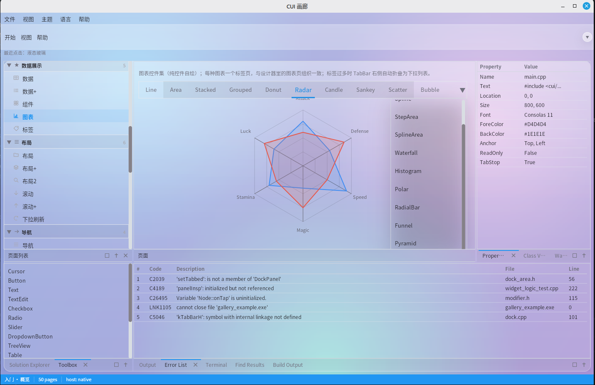
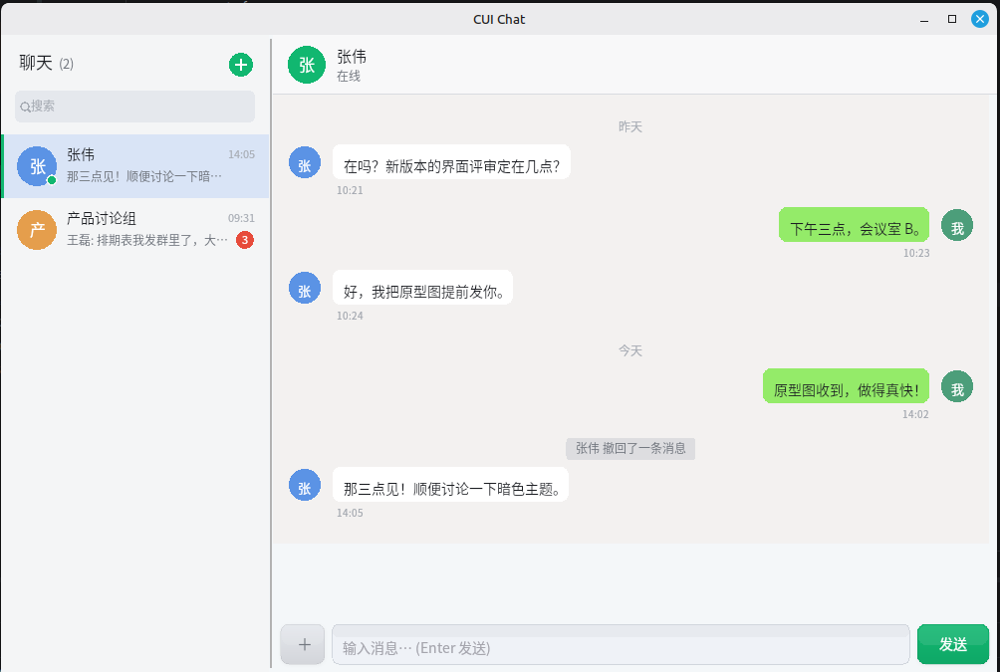
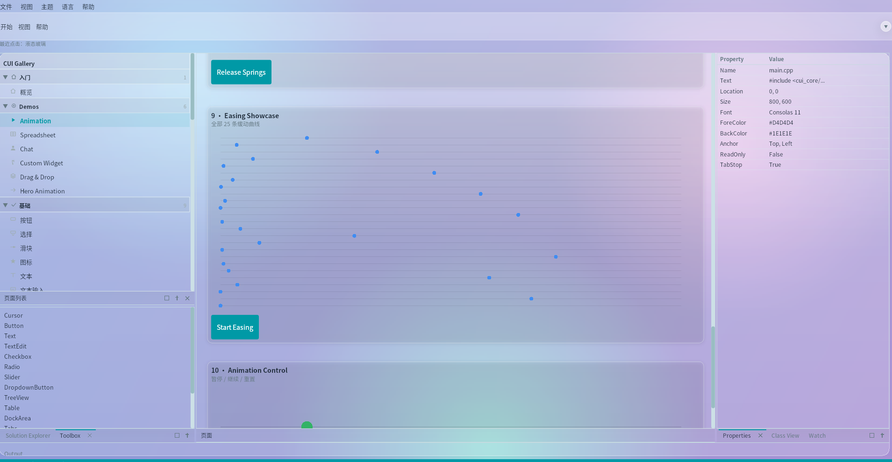
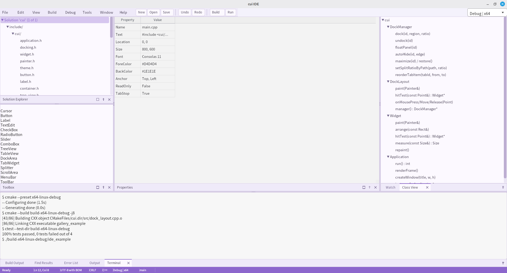

# Flutter-CXX (Flutter for C++)

基于 **C++20 + Skia** 的跨平台**自绘 GUI 框架**：**Widget / Element / RenderObject 三层流水线** + 响应式单向数据流，控件、布局、动画、渲染全部自绘，一套代码跑桌面、移动与 Web。

[English](README.md) | [简体中文](README_zh.md)

<p align="center">
  &nbsp;
  
</p>

<p align="center">
  &nbsp;
  &nbsp;
  &nbsp;
  
</p>

<p align="center">
  &nbsp;
  &nbsp;
  
</p>

## 效果展示

下面四张图全部由框架自绘（Skia 软件光栅），任何平台都没有混用原生控件。

| | |
|:---:|:---:|
| <br>**`story` 的停靠式 IDE 外壳** —— 「图表」页雷达图标签：14 种自绘图表控件共用一个 `ChartHost`，标签过多时 TabBar 自动折叠为下拉列表。 | <br>**Chat 示例**（`CUI_PAGE=3`）—— 会话列表、气泡、日期分隔、未读徽章、`CircleAvatar`，底部输入条走完整的 IME 文本输入链路。 |
| <br>**Animation 页**（`CUI_PAGE=1`）—— 缓动曲线展示区，每条曲线一行圆点，由 `AnimationController` + `CurvedAnimation` 驱动；截图用的是「液态玻璃」外观（`CUI_GLASS=1`）。 | <br>**可视化设计器** —— 目标 `vs2022`（`CUI_BUILD_IDE`，源码在 [`ide/`](ide)）：工程树、Toolbox、属性表、类视图与内置终端。 |

画廊窗口与设计器共用同一套 `cui_dock` 停靠布局：页面列表、Solution Explorer、Toolbox、属性表、终端、Error List。状态条上的页数是**截图当时的快照**，实时页数见下文「示例与验证」。

本地重截任意页：

```bash
CUI_PAGE=19 CUI_SHOT=charts.png CUI_EXIT_AFTER_START=1 ./dist/story
CUI_PAGE=1  CUI_GLASS=1 CUI_SHOT=animation.png CUI_EXIT_AFTER_START=1 ./dist/story
```

- 引擎核心 `cui_core`、控件层 `cui_wx`、四个独立控件包 `packages/*` 共用 `cui` 命名空间与 `#include "cui/..."`。
- 桌面示例 [`story`](examples/story.cpp) 是一棵 **51 页**的控件树（图表、视频、停靠、图像工具、设计器外壳等），桌面 / Web / 移动用的就是**同一棵树**。
- 状态管理可选 `Store<State, Action>`（MVI）：`dispatch(Action) → reducer → Property.changed() → setState()`；[值输入页](examples/story_shell.cpp)（`CUI_PAGE=15`）有可交互示例。
- 当前测试面：Linux debug 树注册 **60 项 CTest**；控件层 **54 个头文件**（51 个顶层 + `animation/` 下 3 个）。

## 目录结构

原 `flutter/` 已拆分为 `cui_core/`（引擎核心）与 `cui_wx/`（控件层），`flutter_basic/`、`flutter_extra/` 已并入相应目录。

```
cui/
├── cui_core/                  # 引擎核心（库目标 cui_core）
│   ├── include/cui/{foundation,framework,rendering,platform,reactive,utils}
│   └── src/{foundation,framework,rendering,platform}
│       └── platform/           # x11 / wayland / win32 / cocoa / ios / android / ohos / web + services
├── cui_wx/                    # 控件层（库目标 cui_wx）
│   ├── include/cui/widgets/   # 51 个控件头 + animation/ 子目录（共 54 个 .h）
│   └── src/widgets/
├── packages/                  # 独立控件包（各自一个库，单向依赖 cui_wx）
│   ├── charts/                # cui_charts：14 种图表控件，全部自绘
│   ├── code_editor/           # cui_code_editor
│   ├── dock/                  # cui_dock
│   └── video/                 # cui_video（系统解码器 + FFmpeg 两条路线）
├── examples/                  # story（桌面/Web/移动共用一棵控件树）+ App 资产
│   ├── platform/android/      # APK 入口的 AndroidManifest.xml
│   └── res/                   # i18n 资源（strings*.xml / translations.ini）
├── ide/                       # 可视化设计器（目标 vs2022，CUI_BUILD_IDE）
├── cmake/                     # 一键构建实现 + 平台工具链 + vcpkg overlay ports
├── scripts/                   # package_{apk,hap,ipa,web}.sh + web_verify.mjs
├── tests/                     # 60 项 CTest 用例
├── docs/BUILDING.md           # 安装/打包/跨平台构建完整说明
├── dist/                      # 统一产物输出（库 / 示例 / IDE / 测试，可整体拷走运行）
├── AGENTS.md                  # 开发约定、架构口径与历史踩坑（改代码前先读）
├── LICENSE                    # MIT 许可证全文
└── screen/                    # 上文效果展示的四张截图
```

**库链接**：目标 `cui` 是 INTERFACE 聚合（`cui_wx` + `cui_core`），四个包按需单独链 `cui_charts` / `cui_code_editor` / `cui_dock` / `cui_video`。两个引擎目录的 `include/` 同时挂到 include path，所以头文件路径不带目录前缀。

移动端的宿主入口留在引擎里（`cui_core/src/platform/{android,ohos,ios}`：native main、Java / Swift / ArkTS 平台桥、HAP 与 XcodeGen 工程骨架），只有 app 产物的构建定义在 `examples/CMakeLists.txt`。

## 快速开始

### 依赖

- C++20 编译器（GCC 13+ / Clang 16+ / MSVC 19.35+）、CMake 3.20+（建议 3.25+）、Ninja
- [vcpkg](https://github.com/microsoft/vcpkg)（Skia / FFmpeg / ICU 等，需 `VCPKG_ROOT`）
- Linux：`libxcb`、`fontconfig`、`libX11`（可选，缺省时 XIM 中文输入被编译掉）
- Android：`ANDROID_NDK_HOME`；OHOS：`OHOS_NDK_HOME`；Web：[emsdk](https://emscripten.org/)（`EMSDK`）；iOS：macOS + Xcode + XcodeGen

### 构建

```bash
bash build.sh                      # Linux / macOS：debug 全量构建 + ctest
bash build.sh release              # Release
bash build.sh linux asan           # Sanitizer
bash build.sh web --serve          # wasm 构建并起本地 HTTP 服务
bash build.sh --help               # 平台 / profile / 全部选项
```

```bat
build.cmd                          :: Windows：当前主机 debug 全量构建 + ctest
build.cmd release
build.cmd --help
```

两个入口脚本本身是纯 CMake（`cmake/build.cmake`），只是把参数翻译成 `CMakePresets` 调用，所以脚本构建与 IDE / CI 直接跑预设的结果完全一致。Windows 上 `build.cmd` 会自己找 VS 并加载 `vcvars64.bat`，**不需要 Git Bash**。

也可直接用 [CMakePresets.json](CMakePresets.json)：

```bash
cmake --list-presets=all
cmake --preset x64-linux-debug      # 或 x64-windows-* / macos-* / ios-* / android-* / wasm32-emscripten-*
cmake --build build-x64-linux-debug
ctest --test-dir build-x64-linux-debug --output-on-failure   # 60 项
./dist/story                       # 全部产物统一落在仓库根 dist/
```

常用开关（根 `CMakeLists.txt`）：`CUI_BUILD_EXAMPLES`、`CUI_BUILD_IDE`、`CUI_BUILD_TESTS`（默认 ON），`CUI_VIDEO_FFMPEG`、`CUI_VIDEO_FFMPEG_VCPKG`、`CUI_ENABLE_INSTALL`，另有 `CUI_LIBRARY_TYPE`、`CUI_SANITIZE`、`CUI_DIST_DIR`。完整选项表见 [docs/BUILDING.md](docs/BUILDING.md)。

平台专属说明：Web 特有限制见 [cui_core/src/platform/web/README.md](cui_core/src/platform/web/README.md)；OHOS 需要把 `OHOS_SDK_ROOT` 设成 `native/` 的**上一级**。

### 最小示例

真实 API：`cui::SharedPtr` / `cui::make_shared`、`StatefulWidget` + `State::setState()`（控件是不可变配置，不要试图给 `Text` 就地改字符串）。

```cpp
#include "cui/foundation/application.h"
#include "cui/widgets/basic.h"        // Column
#include "cui/widgets/interactive.h"  // ElevatedButton
#include "cui/widgets/text.h"         // Text / TextStyle

using namespace cui;

class HelloPage : public StatefulWidget {
public:
    std::unique_ptr<State> createState() override;
    std::string toStringShort() const override { return "HelloPage"; }
};

class HelloPageState : public State {
public:
    SharedPtr<Widget> build(BuildContext&) override {
        auto label = cui::make_shared<Text>(
            "Clicked " + std::to_string(count_) + " times", TextStyle().size(24.0));
        auto button = cui::make_shared<ElevatedButton>(
            cui::make_shared<Text>("Click Me"),
            [this] { ++count_; setState(); });
        auto col = cui::make_shared<Column>(
            std::vector<SharedPtr<Widget>>{label, button});
        col->setMainAxisSize(MainAxisSize::Min);
        return col;
    }
private:
    int count_ = 0;
};

std::unique_ptr<State> HelloPage::createState() {
    return std::make_unique<HelloPageState>();
}

int main() {
    Application app;
    app.createWindow("Hello CUI", 400, 300);
    app.setRoot(cui::make_shared<HelloPage>());
    return app.run();
}
```

`Application` 另支持多窗口（`createWindow` / `closeWindow` / `windowCount`）、离屏窗口（`createOffscreenWindow`、`saveScreenshot`，无窗口也能出帧）与跨线程任务（`runAsync` / `postTask`）。

### 状态管理：Store（MVI）

[`cui_core/include/cui/utils/store.h`](cui_core/include/cui/utils/store.h) 提供 `Store<State, Action>`：状态是值语义、reducer 是纯函数、`Property<State>.changed()` 是 `Signal`，订阅后触发 `setState()` 重建。

```cpp
#include <variant>
#include "cui/utils/store.h"

struct CounterState {
    int count = 0;
    bool operator==(const CounterState&) const = default;  // Property 判重需要
};
struct Inc {};
struct Dec {};
using Action = std::variant<Inc, Dec>;

int main() {
    cui::Store<CounterState, Action> store(CounterState{},
        [](const CounterState& s, const Action& a) -> CounterState {
            if (std::holds_alternative<Inc>(a)) return {s.count + 1};
            return {s.count - 1};
        });

    store.subscribe([](const CounterState& s) { /* setState() 重建视图 */ });
    store.dispatch(Inc{});
    // store.currentState() 取快照；store.state().changed() 直接连 Signal
    return store.currentState().count;
}
```

**可运行示例**：`story` 的「值输入」页（`CUI_PAGE=15`）里的 `StoreDemo` —— SpinBox / ButtonGroup 只 `dispatch(Action)`，`Store` 是唯一真源，界面显示 count、dispatch 次数、最近 Action、步长与对齐。

## 核心架构

### 三层流水线

```
    Widget (不可变配置)  ── createElement() ──▶  Element (生命周期/重建)
                                                    │ owns
                                                    ▼
                                            RenderObject (布局/绘制/命中)
```

| 层 | 目录 | 关键类 |
|----|------|--------|
| Foundation | `cui_core/include/cui/foundation` | `Key`, `Size`, `Offset`, `BoxConstraints`, `Theme`, `Ticker`, `SharedPtr` |
| Rendering | `cui_core/include/cui/rendering` + `cui_core/src/rendering` | `RenderObject`, `RenderBox`, `RenderFlex`, `RenderView`, `PipelineOwner`, `PaintingContext`, `RenderViewport` |
| Framework | `cui_core/include/cui/framework` + `cui_core/src/framework` | `Widget`, `State`, `BuildOwner`, `SchedulerBinding`, `FocusManager`, `Overlay`, `Application` |
| Widgets | `cui_wx/` | 布局 / 文本 / 输入 / 交互 / 滚动 / 动画 / 对话框 / 导航 |

每帧五阶段：`handleBeginFrame`（推进 Ticker）→ `flushBuildScope`（重建脏 Element）→ `flushLayout` → `flushCompositingBits` → `flushPaint + composite`（脏区光栅化到 SkCanvas）。动画时间只在第一阶段推进，不在 `paint` 内推进。

**布局协议**是 Flutter 风格的约束式布局：`BoxConstraints` 向下传递，`RenderBox::performLayout()` 决定自身尺寸，父节点给子节点定位（不是 `measure/arrange`）。`RenderCustomPaint` 在紧约束下用 `constraints.constrain(preferredSize)` 撑满 —— 图表等自绘控件因此能自动适配父容器。

### 响应式原语

```
Signal<Args...>     ── connect / disconnect / emit（快照迭代，重入安全）
Property<T>         ── 值变化时发 changed()（需 T 可 == 比较）
Observable<T>       ── filter / map / combine_latest 等流算子
Store<State,Action> ── MVI 单向数据流，见上
```

都在 `cui_core/include/cui/reactive/`，`Store` 在 `cui/utils/store.h`。

### 主题与国际化

- 8 套预设：`Theme::light/dark/ocean/forest/skyBlue/orange/lavender/ide`，`Theme::fromName()`；`story` 可用 `CUI_THEME=dark` 直接切换。
- `Translator::instance().loadFromDirectory("examples/res")` 载入 `strings*.xml` / `translations.ini`，`setLanguage()` + `tr(key)` 切换；随包 5 种语言：`en` / `zh` / `zh-TW` / `fr` / `ko`（启动语言用 `CUI_LANG` 指定）。

### 动画

`cui_wx/include/cui/widgets/animation/animation.h`：`Animation<T>` / `AnimationController` / `Tween<T>` / `CurvedAnimation` / `SpringSimulation` / `TweenSequence`，26 种 `Easing`（含 `Spring`），`fadeIn()` / `slideIn()` 便捷构造。显式动画族在 `widgets/transition.h`（Fade / Scale / Rotation / Slide / Size / Align / Matrix Transition、`ListenableBuilder`、`ValueListenableBuilder`），隐式动画族在 `widgets/implicit_animation.h`（`AnimatedOpacity/Scale/Rotation/Slide/Padding/Align/Positioned/Container`、`AnimatedSwitcher`、`AnimatedCrossFade`、`TweenAnimationBuilder`），`AnimatedSize` 在 `widgets/animated_size.h`。

## 控件与包

### 基础输入

| 控件 | 说明 |
|------|------|
| `ElevatedButton` / `OutlinedButton` / `TextButton` / `IconButton` | 按钮族（支持海拔、焦点环、InkWell 涟漪） |
| `Checkbox` / `Radio` / `ButtonGroup` | 勾选与互斥选择 |
| `Slider` / `SpinBox` / `LinearProgressIndicator` / `Switch` | 数值与开关 |
| `DropdownButton` / `ComboBox` / `TextField` / `RichTextEditor` | 下拉与文本输入（含 IME / 焦点路由） |
| `CodeEditor`（包） | 语法高亮多行编辑器 |

### 数据展示

`Text` / `RichText`、`Card`、`Badge`、`CircleAvatar`、`Chip`、`Tooltip`、`TreeView`、`Calendar`、`ListView`、`GridView`、`SnackBar`。表格类需求见 `story` 的 Spreadsheet 示例页与 `packages/code_editor`。

**懒加载列表（sliver）**：`ListView::builder` / `ListView::separated` / `GridView::builder` 走 `CustomScrollView + SliverList/SliverGrid`，只构建可见窗口 ±`cacheExtent` 的子节点；`ListView(children)` / `GridView.count` 为急切入口。`VirtualList`（`CUI_PAGE=27`）更进一步：行只是「数据模型 + Painter 回调」，整棵树只有一个叶子 RenderObject，10^6 行也只占用 O(可见行数) 的绘制调用。百万行数据无需全部驻留内存。

### 布局

`Column` / `Row` / `Flex` / `Expanded`、`Wrap`、`Stack` / `Positioned`、`Align` / `Center`、`SizedBox`、`Container`、`SingleChildScrollView` / `CustomScrollView`、`Splitter`、`IntrinsicWidth` / `IntrinsicHeight`。

### 高级组件

`TabBar` / `TabBarView` / `Tabs`、`Ribbon`、`MenuBar`、`AlertDialog` / `SimpleDialog`、`PopupMenuButton`、`Drawer`、`BottomSheet`、`NavigationRail`、`ExpansionTile`、`Stepper`、`SearchBar`、`RatingBar`、`ColorPicker`、`TimePicker` / `DatePicker`、`AppBar` / `Scaffold`、`InkWell`、`Hero`、`Draggable` / `DragTarget`、`NotificationListener`、`MouseRegion`、`InteractiveViewer`、`PhotoView`、`ExtendedImage`、`ImageEditor`、`AutoHideToolbar`、`LiquidGlass`、`AsyncBuilder`。

### 独立包

| 包 | 目标 | 内容 |
|----|------|------|
| `packages/charts` | `cui_charts` | `ChartHost` 之上的 14 个图表控件：折线/柱状（分组、堆叠）/饼/散点/雷达/气泡/瀑布/直方/蜡烛/桑基/极坐标/环形进度/漏斗/金字塔，纯自绘 + 悬停提示 |
| `packages/code_editor` | `cui_code_editor` | 代码编辑器 |
| `packages/dock` | `cui_dock` | VS 风格可停靠面板（图钉、折叠、拆分） |
| `packages/video` | `cui_video` | 两条路线共用一张后端表：系统解码器（MF / AVFoundation / AMediaCodec / OH_AVDemuxer / GStreamer / HTMLVideoElement）+ FFmpeg，音频经 `AudioRing` 与平台 sink |

平台服务（相机、蓝牙、触觉反馈、文件对话框、权限、SystemChrome、SystemNavigator、method/event channel）声明在 `cui_core/include/cui/platform/services/`，「系统服务」页（`CUI_PAGE=47`）有实机可点的示例卡。

## 平台支持

呈现统一走 Skia 软件/Graphite 光栅化 → `AppWindow::blitToNativeWindow()` / `presentPixels()` 交给各平台窗口或 surface。

| 平台 | 后端 | 当前验证程度 |
|------|------|--------------|
| Linux | XCB/X11（XIM 输入法）、Wayland | ✅ 主力开发环境，debug/release/ASan/UBSan 预设，注册 60 项 CTest |
| Windows | Win32 + WASAPI + Media Foundation | ✅ 真机 MSVC 全树构建 + ctest 全绿 |
| Web | Emscripten + Canvas 2D `putImageData` | ✅ release wasm 在 headless Chrome 上渲染与点击跑通 |
| Android | NDK + `ANativeWindow`（软件 blit） | ✅ APK 打包 + 模拟器渲染/触摸验证（软键盘 IME 未接） |
| HarmonyOS | OHOS NDK + ArkTS 宿主 | ⚠️ 真 NDK 26 编译/链接通过（含 skia），未上设备 |
| iOS | UIKit + `CALayer.contents` | ⚠️ 后端、Xcode 工程与 IPA 脚本齐备，未上真机 |
| macOS | Cocoa | ⚠️ 目前只做过分支/语法校验 |

移动/Web 打包脚本：`scripts/package_apk.sh`、`package_hap.sh`、`package_ipa.sh`、`package_web.sh`（`--verify` 跑浏览器验证、`--serve` 起服务）。iOS 的 `width()/height()` 返回设备像素（逻辑点数 × `UIScreen.scale`），触摸坐标同步换算，实现 Retina 清晰；Web 呈现用 CSS 像素，DPR 只上报不放大 backing store。Wayland 已有实现但 CMake 尚未接线（需要 `wayland-scanner` 生成 xdg-shell 协议头）。

## 示例与验证

### 可执行目标

| 目标 | 说明 |
|------|------|
| `story` | 51 页控件展示（唯一的应用根由 `cui_app_root` 注入，桌面/Web/移动共用同一棵树） |
| `vs2022` | 可视化设计器（`CUI_BUILD_IDE`） |
| `story.html` | Web 产物（html/js/wasm/data）与桌面/移动库、可执行文件一样统一落在根 `dist/`，需 HTTP 打开（`scripts/package_web.sh --serve`） |

`CUI_PAGE=<n>` 直跳页面，当前注册表下标：0=概览、1=Animation、15=值输入（Store 示例）、19=图表、27=Virtual List、42=尺寸动画、43=intrinsic、48=图像、49=视频、50=多窗口。下标随注册表变动，别凭记忆点坐标，改前读 `GalleryShell::pages()`，或用按名查的 `GalleryShell::indexOf("视频")`（名字照注册表原文，多条是中文）。

### 离屏冒烟（`examples/story.cpp`）

| 环境变量 | 作用 |
|----------|------|
| `CUI_PAGE=<n>` | 启动直达第 n 页 |
| `CUI_SHOT=<path>` | 渲染一帧存 PNG（先执行 `CUI_SEQ` 再截图） |
| `CUI_EXIT_AFTER_START=1` | 渲染一帧即退出（批量脚本必加，否则窗口常驻） |
| `CUI_SEQ="click:100,200;scroll:400;tick:3"` | 动作序列：down/hover/up/click/rclick/scroll/tick/key/keycode |
| `CUI_THEME=dark` / `CUI_LANG=en` | 启动主题 / 语言 |
| `CUI_GLASS=1` | 以「液态玻璃」外观启动 |
| `CUI_MINIMAL=1` | 只挂最小树（验证宿主桥接） |
| `CUI_VIDEO=<路径或 URL>` / `CUI_VIDEO_BACKEND=<auto\|system\|ffmpeg>` | 视频页素材 / 解码路线 |
| `CUI_FORCE_RASTER=1` | 绕开 GPU 后端，强制 CPU 光栅 |
| `CUI_FPS_INTERVAL_MS=<n>` | 覆盖帧间隔 |

```bash
export TMPDIR=$PWD/build-x64-linux-debug/tmp   # /tmp 空间很小时编译前必设
CUI_PAGE=15 CUI_SEQ="scroll:500,400,400;tick:20" CUI_SHOT=/tmp/value.png \
  CUI_EXIT_AFTER_START=1 ./dist/story
ctest --test-dir build-x64-linux-debug --output-on-failure   # 60 项
node scripts/web_verify.mjs --dir dist \
  --shot /tmp/web.png --click 95,353
```

`CUI_SEQ` 坐标是 PNG 真实像素（gallery 窗口 1080×800），不是缩放后显示图的肉眼位置。

## 文档索引

- [README.md](README.md) — English version
- [AGENTS.md](AGENTS.md) — 开发约定、架构口径、平台踩坑与历史决策（修改框架代码前必读）
- [docs/BUILDING.md](docs/BUILDING.md) — 依赖安装、各平台构建/调试/打包与 Sanitizer
- [cui_core/src/platform/web/README.md](cui_core/src/platform/web/README.md) — Web/WASM 特有限制与字体
- [CMakePresets.json](CMakePresets.json) — 全部构建预设
- `packages/video/src/video_backends.{h,cpp}` — 视频解码后端总表（详见 AGENTS.md 的「视频解码后端」节）

## 许可证

MIT License —— 全文见 [LICENSE](LICENSE)。[`vcpkg.json`](vcpkg.json) 里的声明与之一致（`"license": "MIT"`）。
